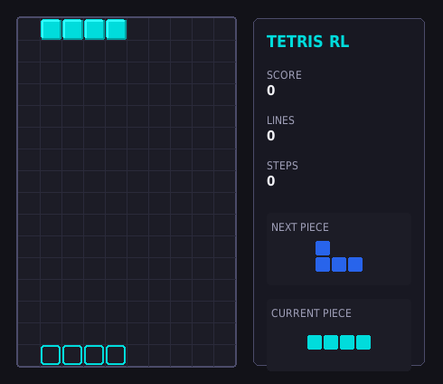
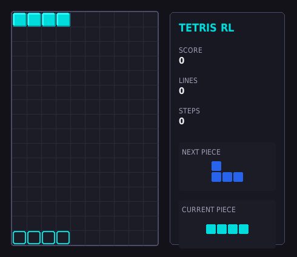
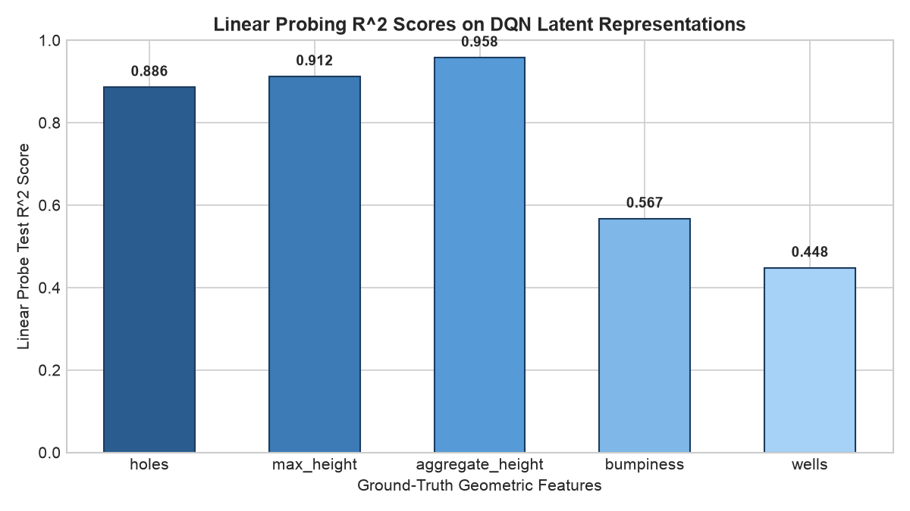
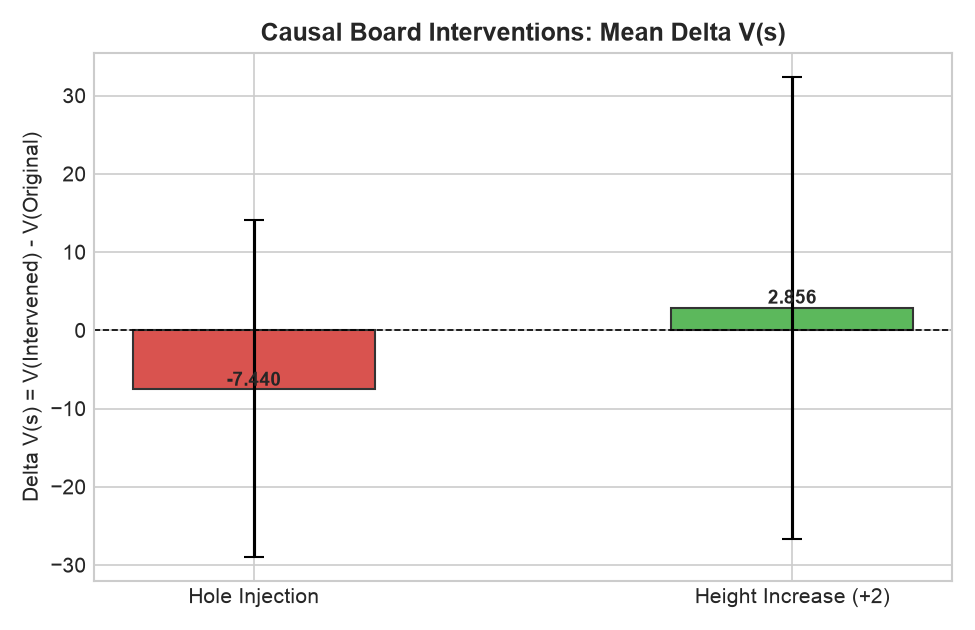

# Tetris RL: Algoritma atau Representasi? CEM vs Deep RL di Tetris

[](https://www.python.org/downloads/release/python-3120/)
[](tests/)
[](https://gymnasium.farama.org/)
[](LICENSE)

> **Pertanyaan Riset Inti:** Ketika terjadi perbedaan performa yang masif antara metode klasik berbasis fitur linear dan Deep RL di Tetris, apakah perbedaan tersebut berakar dari **Algoritma** (*Gradient-Free CEM* vs *Gradient-Based TD/DQN*) ataukah dari **Representasi Keadaan** (*Fitur Linear Dellacherie* vs *Papan Spasial Mentah 200-dimensi*)?

Proyek riset portofolio Reinforcement Learning ini mengisolasi dan menjawab pertanyaan tersebut secara kausal melalui **desain faktorial $2 \times 2$**, protokol evaluasi multi-seed yang ketat (5 seed independen, 25 episode per model), metrik statistik tangguh (*Interquartile Mean* dan *95% Bootstrap Confidence Interval* via `rliable`), serta analisis interpretabilitas laten via *Linear Probing*.

---

## Demo Visual Gameplay

| Sebelum Belajar (Random Baseline) | Sesudah Belajar (Trained CEM Agent) |
|:---:|:---:|
|  |  |
| *IQM Skor: 0.0 \| Bertahan rata-rata 20 piece* | *IQM Skor: 55.169,2 \| 498 baris per episode* |

---

## Hasil Utama: Desain Faktorial $2 \times 2$

```
========================================================================================
                          MATRIKS FAKTORIAL 2x2 (Skor Evaluasi IQM)
========================================================================================
                                 Fitur Linear (Dellacherie 4)   Papan Mentah (Raw 200)
----------------------------------------------------------------------------------------
Gradient-Free (CEM)                       55.169,2                       0,0
Gradient-Based (TD / DQN)                    400,0                       0,0
========================================================================================
```

### Kesimpulan Inti (1–2 Kalimat):
> **Kesenjangan performa di Tetris secara dominan ditentukan oleh REPRESENTASI KEADAAN, bukan algoritma optimasi.**  
> Baik algoritma berbasis gradien (DQN) maupun bebas gradien (CEM) sama-sama gagal total (skor IQM 0,0) pada representasi papan spasial mentah $2^{200}$, sedangkan pada fitur linear terstruktur kedua keluarga algoritma berhasil belajar membersihkan baris secara konsisten.

---

## Tabel Hasil Perbandingan Multi-Seed Lengkap

Evaluasi resmi dilakukan pada 5 random seed independen (25 episode per model, capped 10.000 langkah):

| ID / Model | Algoritma / Tipe | Representasi | Skor IQM | 95% Bootstrap CI | Baris Dihapus | Langkah Bertahan |
|---|---|---|---|---|---|---|
| **Baseline Heuristic** | Dellacherie (Literatur) | Fitur Linear (4) | **61.461,5** | [39.569,6; 93.086,2] | 558,6 baris | 1.440,0 piece |
| **Baseline Random** | Random Legal | Raw Board (200) | **0,0** | [0,0; 0,0] | 0,0 baris | 20,3 piece |
| **E1 (CEM-Features)** | Cross-Entropy Method | Fitur Linear (4) | **55.169,2** | [34.792,3; 89.749,2] | 498,6 baris | 1.290,1 piece |
| **E2 (TD-Features)** | Semi-Gradient TD(0) | Fitur Linear (4) | **400,0** | [223,1; 592,3] | 3,1 baris | 51,0 piece |
| **E2 (CEM-Net)** | Neuroevolution Linear | Raw Board (200) | **0,0** | [0,0; 0,0] | 0,0 baris | 23,7 piece |
| **E2 (TD-Net / DQN)** | Deep Q-Network Afterstate | Raw Board (200) | **0,0** | [0,0; 0,0] | 0,0 baris | 27,9 piece |
| **E3 (PPO-Masked)** | MaskablePPO (Policy Grad) | Raw Board (200) | **0,0** | [0,0; 0,0] | 0,0 baris | 8,0 piece |
| **E4 (Reward R1)** | DQN + Survival Bonus | Raw Board (200) | **46,2** | [7,7; 130,8] | 0,5 baris | 32,3 piece |

*Catatan Ceiling Effect:* Pada papan standar $10 \times 20$, rasio tersensor (*censored ratio*) adalah **0,0%** (tidak ada episode yang menyentuh batas 10.000 piece), membuktikan bahwa benchmark bebas dari artefak saturasi atap papan.

---

## Interpretabilitas Representasi Laten

Apakah jaringan saraf tiruan (DQN) yang dilatih dari papan biner mentah secara implisit memahami geometri papan?

| Linear Probing Laten ($R^2$ Score) | Intervensi Kausal ($\Delta V(s)$) |
|:---:|:---:|
|  |  |
| *Hidden layer mengodekan Aggregate Height ($R^2=0.958$), Max Height ($R^2=0.912$), dan Holes ($R^2=0.886$).* | *Penyuntikan lubang buatan menurunkan estimasi nilai papan ($\Delta V = -7.440$).* |

---

## Cakupan & Penyederhanaan Aturan Game

Sesuai metodologi standar riset AI Tetris (Dokumen Proyek Bagian 3.2):
- **Ruang Aksi:** *Final Placement* (rotasi + kolom), menghasilkan maksimal 40 aksi diskrit (`Discrete(40)`).
- **Hard Drop 1 Langkah:** Tanpa gravitasi bertahap (memaksimalkan throughput simulasi hingga >10.000 steps/detik via Numba JIT).
- **Penyederhanaan:** Tidak memodelkan gerakan *tuck* (sliding di bawah overhang), *wall kick*, *T-spin*, maupun fitur *hold*.
- **Rotasi Unik:** Menghilangkan redundansi simetris (Piece O: 1 rotasi, I/S/Z: 2 rotasi, T/J/L: 4 rotasi; total 19 penempatan unik).

---

## Petunjuk Setup di Ubuntu / Linux

```bash
# 1. Clone repositori
git clone https://github.com/lavvvet/tetris-DRL.git
cd tetris-DRL

# 2. Buat virtual environment berbasis Python 3.10+
python3 -m venv .venv
source .venv/bin/activate

# 3. Instal dependensi murni CPU (ringan, ~400 MB, hemat disk)
pip install -e ".[dev]"
pip install --no-cache-dir torch --index-url https://download.pytorch.org/whl/cpu
pip install --no-cache-dir stable-baselines3 sb3-contrib tensorboard
```

---

## Menjalankan Pengujian Otomatis

Seluruh 66 unit test (mencakup aturan rotasi, akselerasi Numba, kesetaraan NumPy, Gymnasium `check_env`, determinisme seed, agen, dan analisis interpretabilitas) dapat dijalankan dengan:

```bash
PYTEST_DISABLE_PLUGIN_AUTOLOAD=1 pytest tests/
# Output: 66 passed in ~6.0s (100% green)
```

---

## Cara Reproduksi Eksperimen (Cepat & Skala Penuh)

### 1. Evaluasi Cepat Baseline Klasik 
```bash
python scripts/evaluate.py --config configs/baseline_heuristic.yaml
```

### 2. Pelatihan Linear TD(0) Afterstate 
```bash
python scripts/train.py --config configs/e2_td_features.yaml
```

### 3. Pelatihan Cross-Entropy Method 
```bash
python scripts/train.py --config configs/e1_cem_features.yaml
```

### 4. Pelatihan Deep Q-Network Afterstate 
```bash
python scripts/train.py --config configs/e2_td_net.yaml
```

### 5. Menjalankan Analisis Interpretabilitas 
```bash
python scripts/analyze.py --model models/final/e2_td_net_best.pt
```

### 6. Merekam Animasi Gameplay ke GIF
```bash
python scripts/record.py --agent cem --output docs/assets/demo_cem.gif
```

---

## Struktur Repositori

```text
tetris-rl/
├── README.md                    # Ringkasan portofolio, tabel hasil utama, dan GIF demo
├── pyproject.toml               # Dependensi dengan versi terpatok
├── .gitignore                   # Mengabaikan checkpoint perantara dan cache
│
├── tetris_rl/                   # Paket kode sumber utama
│   ├── pieces.py                # Definisi 7 tetromino, bounding box, dan 19 rotasi unik
│   ├── board.py                 # Engine referensi NumPy murni
│   ├── board_fast.py            # Engine terakselerasi Numba JIT (>10.000 steps/sec)
│   ├── features.py              # Ekstraksi fitur buatan tangan (Dellacherie)
│   ├── env.py                   # Antarmuka Gymnasium TetrisEnv (Discrete(40), R0-R3)
│   ├── render_text.py           # Visualisasi terminal (ASCII & Unicode)
│   ├── render_pygame.py         # Visualisasi grafis Pygame headless & eksportir GIF
│   ├── agents/                  # Koleksi agen RL
│   │   ├── random_agent.py      # Agen acak legal (lower bound)
│   │   ├── heuristic.py         # Agen linear berbobot Dellacherie
│   │   ├── cem.py               # Cross-Entropy Method dengan akuntansi piece jujur
│   │   ├── td_afterstate.py     # Linear TD(0) & Deep Q-Network Afterstate
│   │   └── ppo_masked.py        # MaskablePPO dengan action masking
│   ├── eval/                    # Protokol evaluasi multi-seed & kalkulasi IQM (rliable)
│   └── analysis/                # Linear probing dan intervensi kausal
│
├── tests/                       # Suite pengujian otomatis (66 tests lulus 100%)
├── configs/                     # File konfigurasi eksperimen (YAML)
├── scripts/                     # Skrip CLI (train, evaluate, record, analyze, view_live)
├── docs/                        # Dokumentasi teknis (environment.md, experiments.md, assets/)
└── report/                      # Laporan riset ilmiah lengkap (report.md) & log keputusan (decisions.md)
```

---

## Lisensi & Referensi

Didistribusikan di bawah lisensi MIT. Silakan lihat [`LICENSE`](LICENSE) untuk informasi lebih lanjut.

### Referensi Literatur

#### Literatur Modern (2020 ke Atas)
1. **Agarwal, R., Schwarzer, M., Castro, P. S., Courville, A. C., & Bellemare, M. G. (2021).** *Deep reinforcement learning at the edge of the statistical precipice*. Neural Information Processing Systems. *(Metodologi evaluasi statistik baku: IQM, stratified bootstrap 95% CI via `rliable`).*
2. **Huang, S., & Ontañón, S. (2022).** *A closer look at invalid action masking in policy gradient algorithms*. The International FLAIRS Conference Proceedings, 35. *(Landasan teoritis dan empiris MaskablePPO serta penanganan aksi ilegal).*
3. **McGrath, T., Kapishnikov, A., Tomašev, N., Pearce, T., Wattenberg, M., Hassabis, D., ... & Kim, B. (2022).** *Acquisition of chess knowledge in AlphaZero*. Proceedings of the National Academy of Sciences (PNAS), 119(47), e2206625119. *(Metodologi linear probing untuk mengukur representasi laten pada game board).*
4. **Schwarzer, M., Anand, A., Goel, R., Hjelm, R. D., Courville, A., & Bachman, P. (2020).** *Data-efficient reinforcement learning with self-predictive representations*. ICLR 2020. *(Analisis representasi spasial mentah vs efisiensi sampel Deep RL).*
5. **Raffin, A., Hill, A., Gleave, A., Kanervisto, A., Ernestus, M., & Dormann, N. (2021).** *Stable-Baselines3: Reliable Reinforcement Learning Implementations*. elib (German Aerospace Center), 22(268), 1-8. *(Implementasi standar algoritma RL dan pengujian reliabilitas).*
6. **Towers, M., Jordan, J. K., Willems, R., et al. (2025).** *Gymnasium: A Standard Interface for Reinforcement Learning Environments*. Advances in Neural Information Processing Systems 38. *(Spesifikasi antarmuka lingkungan interaksi RL).*
7. **Icarte, R. T., Klassen, T. Q., Valenzuela, R., et al. (2022).** *Reward Machines: Exploiting Reward Function Structure in Reinforcement Learning*. Journal of Artificial Intelligence Research, 73, 173-208. https://doi.org/10.1613/jair.1.12440

#### Fondasi Klasik & Teoretis
9. **Szita, I., & Lőrincz, A. (2006).** *Learning Tetris using the noisy cross-entropy method*. Neural computation, 18(12), 2936-2941. *(Aplikasi Cross-Entropy Method pada game Tetris).*
10. **Bertsekas, D. P. (2001).** *Neuro-dynamic programming*. Encyclopedia of Optimization. *(Formulasi teoretis Afterstate Value Function).*
11. **Ng, A. Y., Harada, D., & Russell, S. (1999).** *Policy invariance under reward transformations: Theory and application to reward shaping*. ICML. *(Invariansi kebijakan optimal di bawah transformasi reward shaping).*
